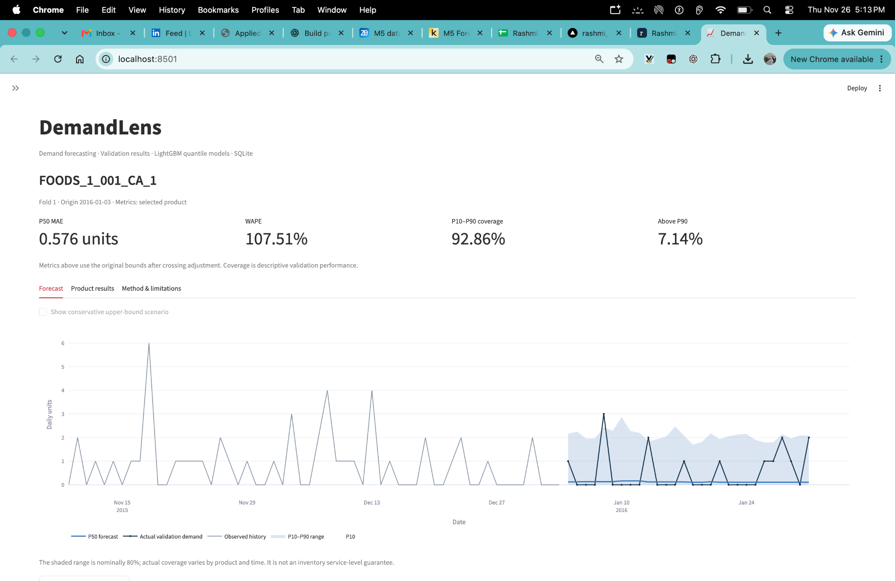
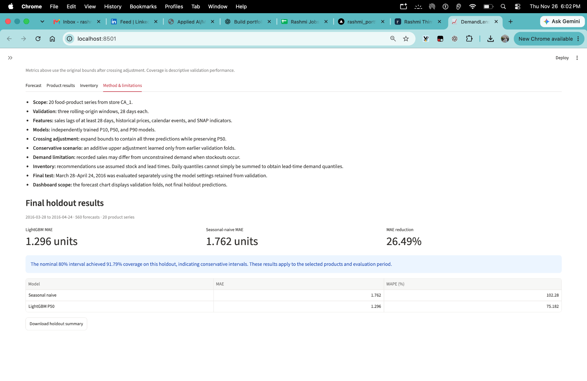

# DemandLens

Retail demand forecasting with LightGBM quantile models,
rolling-origin validation, SQLite, and an interactive Streamlit dashboard.

## Current scope

- 20 food-product series from M5 store CA_1.
- 38,260 daily sales observations.
- Calendar events, SNAP indicators, historical prices, and sales features.
- Three rolling-origin validation folds, each forecasting 28 days.
- P10, P50, and P90 forecasts with uncertainty diagnostics.
- SQL-backed dashboard with product filters and downloadable forecasts.

## Validation results

Results cover 1,680 item-day forecasts across three validation folds.

| Metric | Seasonal naive | LightGBM P50 |
|---|---:|---:|
| MAE | 2.017 | 1.647 |
| WAPE | 104.89% | 85.63% |

LightGBM reduced pooled validation MAE by 18.36%.

The nominal 80% prediction interval achieved 85.65% coverage
after quantile-crossing adjustment. However, 13.45% of actual
observations exceeded P90, showing uneven tail calibration.

A separate conservative upper-bound scenario uses errors from
earlier folds only. It is exploratory and does not guarantee
per-product coverage or inventory service levels.
## Inventory planning scenario

An illustrative order-up-to recommendation for each product:

- 7-day supplier lead time.
- 7-day review period.
- Assumed stock of 5 units per product.
- No orders in transit or backorders.
- Historical sales restricted to dates available at the forecast origin.

The target stock is the rounded-up maximum of:
1. The next 14 days of summed P50 forecasts.
2. The historical 90th percentile of non-overlapping 14-day sales totals.

Recommended order quantity is the positive difference between
target stock and inventory position.

The dashboard includes product-level recommendations, a pre-arrival
shortage-risk flag, assumptions, and downloadable results.

This is a planning snapshot, not a dynamic inventory simulation.
It does not guarantee an inventory service level.
## Setup

Use Python 3.10 or newer.

```bash
python3 -m venv .venv
source .venv/bin/activate
python -m pip install -r requirements.txt
```

On macOS, LightGBM may also require:

```bash
brew install libomp
```
## Forecast dashboard

Product-level demand forecasts showing historical sales,
actual validation demand, P50 predictions, and P10–P90 bounds.


## Data

Download these M5 files and place them in `data/raw/`:

- `sales_train_validation.csv`
- `calendar.csv`
- `sell_prices.csv`

Dataset source:
https://zenodo.org/records/10203108

Raw data is not included in this repository.
Review the source dataset's terms before use.

## Run the workflow

```bash
python check_data.py
python prepare_data.py
python evaluate_baseline.py
python build_features.py
python evaluate_lightgbm.py
python evaluate_quantiles.py
python diagnose_forecasts.py
python evaluate_calibration.py
python build_database.py
python -m streamlit run dashboard.py
```

## Evaluation safeguards

- Products are selected deterministically by item ID.
- Sales-based features use observations at least 28 days earlier.
- Historical price features avoid future realized prices.
- Category encoders are fitted separately within each fold.
- Baseline and LightGBM predictions are matched on identical observations.
- March 28–April 24, 2016 is reserved and remains unevaluated.
## Final holdout results

Models trained using observations through March 27, 2016 were
evaluated on March 28–April 24, 2016.

The holdout contains 560 forecasts across 20 product series.
Model settings were retained from validation.

| Metric | Seasonal naive | LightGBM P50 |
|---|---:|---:|
| MAE | 1.763 | 1.296 |
| WAPE | 102.28% | 75.18% |

LightGBM reduced holdout MAE by 26.49%.

The nominal 80% P10–P90 interval achieved 91.79% coverage,
with a mean width of 4.379 units. Actual demand exceeded P90
on 7.50% of observations; no quantile crossings occurred.

These results describe 20 selected food-product series from
one store and one 28-day holdout, not all M5 products or stores.

The fitted models and category encoder are saved locally in
models/holdout_model_bundle.joblib.
## Limitations and planned work

- Results describe a small subset of one store.
- Recorded sales may understate demand during stockouts.
- Calendar events and SNAP indicators are not direct promotion records.
- Daily quantiles cannot simply be summed into lead-time demand quantiles.
- Inventory reorder simulation, MLflow tracking, and final holdout
  evaluation are planned; they are not implemented yet.
- Inventory recommendations use assumed stock and lead times.
- Dynamic inventory simulation, MLflow tracking, and final holdout
  evaluation remain planned.
### Final evaluation dashboard

