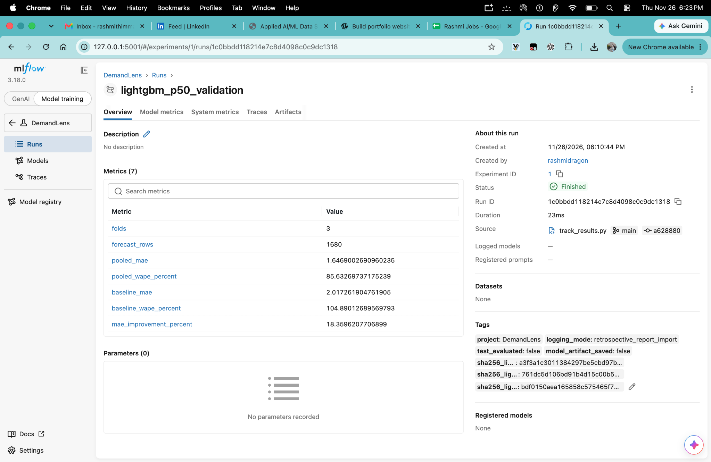

# DemandLens

Retail demand forecasting and inventory planning using LightGBM quantile models, rolling-origin validation, SQLite, MLflow, and an interactive Streamlit dashboard.

**Final holdout result:** LightGBM reduced MAE by **26.49%** compared with a weekly seasonal-naive baseline across 560 forecasts.

## Forecast dashboard

Explore historical sales, actual validation sales, P50 forecasts, and P10–P90 prediction intervals by product and validation fold.


## Project scope

- 20 food-product series from M5 store `CA_1`, selected deterministically by item ID.
- 38,260 daily sales observations.
- Calendar events, SNAP indicators, historical prices, and lagged sales features.
- Three rolling-origin validation folds with a 28-day forecast horizon.
- Separate final holdout covering March 28–April 24, 2016.
- Independently trained P10, P50, and P90 LightGBM models.
- SQLite-backed dashboard with downloadable forecasts and inventory recommendations.

## Technology stack

| Component | Tools |
|---|---|
| Data preparation | Python, pandas, NumPy, PyArrow |
| Forecasting | LightGBM, scikit-learn |
| Storage and queries | SQLite |
| Dashboard | Streamlit, Plotly |
| Report tracking | MLflow |
| Output verification | Python assertions, NumPy, SQLite integrity checks |

## Validation results

Validation covers 1,680 item-day forecasts across three rolling-origin folds.

| Fold | Forecast period |
|---|---|
| 1 | January 4–31, 2016 |
| 2 | February 1–28, 2016 |
| 3 | February 29–March 27, 2016 |

The baseline repeats the last seven observed days across the 28-day forecast horizon.

| Metric | Seasonal naive | LightGBM P50 |
|---|---:|---:|
| MAE, units | 2.017 | 1.647 |
| WAPE | 104.89% | 85.63% |

LightGBM reduced pooled validation MAE by **18.36%**.

After quantile-crossing adjustment, the nominal 80% P10–P90 interval achieved:

| Diagnostic | Result |
|---|---:|
| Coverage | 85.65% |
| Mean interval width, units | 4.442 |
| Actual sales below P10 | 0.89% |
| Actual sales above P90 | 13.45% |

Aggregate coverage masks uneven tail calibration and differences between products.

A separate conservative upper-bound scenario learns an additive adjustment from earlier validation folds only. It is exploratory and does not guarantee coverage for individual products or inventory service levels.

## Final holdout results

Models trained using observations through March 27, 2016 were evaluated on March 28–April 24, 2016.

The final holdout contains **560 forecasts across 20 product series**. Model settings were retained from validation.

| Metric | Seasonal naive | LightGBM P50 |
|---|---:|---:|
| MAE, units | 1.763 | 1.296 |
| WAPE | 102.28% | 75.18% |

LightGBM reduced holdout MAE by **26.49%**.

| Uncertainty diagnostic | Result |
|---|---:|
| Nominal interval coverage | 80% |
| Observed interval coverage | 91.79% |
| Mean interval width, units | 4.379 |
| Actual sales below P10 | 0.71% |
| Actual sales above P90 | 7.50% |
| Raw quantile crossings | 0% |

Coverage above the nominal level indicates conservative intervals on this holdout.

These results apply to the selected products and evaluation period. They do not establish performance across all M5 products or stores.


The fitted models and category encoder are saved locally at:

`models/holdout_model_bundle.joblib`

The dashboard forecast chart displays validation folds. Final holdout metrics are presented separately.

## Forecasting approach

1. Prepare daily item-store sales and join calendar and price information.
2. Evaluate a weekly seasonal-naive baseline.
3. Build sales lags, rolling statistics, historical price features, and calendar features.
4. Fit category encoders using training observations within each fold.
5. Train independent LightGBM quantile models for P10, P50, and P90.
6. Evaluate point accuracy, interval coverage, pinball loss, and quantile crossings.
7. Diagnose product-level errors and assess an exploratory upper-bound adjustment.
8. Generate an illustrative inventory planning scenario.
9. Evaluate the final holdout separately.

When quantiles cross, the bounds are expanded to contain all three predictions while preserving P50.

## Inventory planning scenario

The project generates an illustrative order-up-to recommendation for each product using:

- Forecast origin: February 28, 2016.
- Supplier lead time: 7 days.
- Review period: 7 days.
- Protection period: 14 days.
- Assumed stock: 5 units per product.
- No orders in transit or backorders.
- Historical sales restricted to dates available at the forecast origin.

Target stock is the rounded-up maximum of:

1. The sum of P50 forecasts over the next 14 days.
2. The historical 90th percentile of non-overlapping 14-day sales totals.

Recommended order quantity is:

`max(target stock − inventory position, 0)`

The dashboard includes product-level recommendations, a pre-arrival risk flag, assumptions, and downloadable results.

This is a planning snapshot. It has not been evaluated as a dynamic inventory policy or demonstrated to reduce costs or stockouts.

Summed daily P50 forecasts are a central planning proxy; they are not necessarily the median of total protection-period demand. Daily quantiles cannot simply be summed to obtain lead-time demand quantiles.

## Experiment tracking with MLflow

`track_results.py` imports existing report metrics and artifacts into five MLflow runs:

- `seasonal_naive_validation`
- `lightgbm_p50_validation`
- `lightgbm_quantiles_validation`
- `upper_bound_adjustment`
- `inventory_scenario`

Tracking includes report files, numeric summary metrics, and file hashes.



This is retrospective report logging. It does not retrain models, log model objects, or register models. The five report groups do not include the final holdout evaluation.

From the project directory, import reports with:

```bash
python track_results.py
```

Each execution creates new runs.

Open the local tracking interface with:

```bash
python -m mlflow ui --backend-store-uri sqlite:///tracking/mlflow.db --port 5001
```

Visit [http://localhost:5001](http://localhost:5001), select **Model training**, and open **DemandLens → Runs**.

Tracking data is stored locally under `tracking/` and excluded from Git.

## Data

Download the following files and place them in `data/raw/`:

- `sales_train_validation.csv`
- `calendar.csv`
- `sell_prices.csv`

Dataset source: [M5 data on Zenodo](https://zenodo.org/records/10203108).

Raw data is not included in this repository. Review the dataset source and applicable terms before use.

## Setup

Dependency installation and imports were verified in a fresh Python 3.14 virtual environment on macOS with Apple Silicon. Other Python versions and operating systems have not been verified.

Clone the repository:

```bash
git clone https://github.com/Rashmioffcialpage/Multi-Signal-Demand-Inventory-Forecasting-System.git
cd Multi-Signal-Demand-Inventory-Forecasting-System
```

Create and activate an environment:

```bash
python3.14 -m venv .venv
source .venv/bin/activate
python -m pip install --upgrade pip
```

On macOS, install the OpenMP library required by LightGBM:

```bash
brew install libomp
```

Install Python dependencies:

```bash
python -m pip install -r requirements.txt
python -m pip check
```

## Run the workflow

After placing the raw files in `data/raw/`, run the preparation and validation steps in order:

```bash
python check_data.py
python prepare_data.py
python evaluate_baseline.py
python build_features.py
python evaluate_lightgbm.py
python evaluate_quantiles.py
python diagnose_forecasts.py
python evaluate_calibration.py
python build_database.py
python inventory_recommendations.py
```

Run the final holdout evaluation using the retained model settings:

```bash
python evaluate_holdout.py
```

Import the validation and inventory reports into MLflow:

```bash
python track_results.py
```

Check saved outputs:

```bash
python check_project.py
```

Launch the dashboard:

```bash
python -m streamlit run dashboard.py
```

Open [http://localhost:8501](http://localhost:8501).

The final holdout has already been evaluated. Re-running it reproduces the evaluation; it does not create a new unseen test set.

## Automated output checks

`check_project.py` verifies:

- Expected forecast row counts and product counts.
- Unique product-date observations.
- Finite, nonnegative actuals and quantile forecasts.
- Ordered P10, P50, and P90 bounds.
- Expected validation folds and date ranges.
- Forecast horizons when origin columns are available.
- Separation between validation and holdout dates.
- Agreement between holdout predictions and saved summary metrics.
- SQLite integrity and expected table row counts.

Confirmed checks include dependency installation, dependency consistency, package imports, and saved-output verification in a fresh virtual environment on the development Mac.

A full pipeline rebuild from raw data in that fresh environment and an independent training-time leakage audit remain unverified.

## Evaluation safeguards

- Products are selected deterministically by item ID.
- Sales-based features use observations at least 28 days earlier.
- Historical price features avoid future realized prices.
- Category encoders are fitted separately within each training fold.
- Baseline and LightGBM predictions are matched on identical observations.
- Upper-bound adjustments use earlier validation folds only.
- Inventory scenario calculations exclude future realized sales.
- Final holdout evaluation is separate from validation.

The final holdout is March 28–April 24, 2016 and has been evaluated. Further tuning based on its results would require a new unseen evaluation period.

## Generated files

| Location | Contents |
|---|---|
| `data/processed/` | Prepared sales and model features |
| `data/demandlens.db` | Historical sales and validation forecasts |
| `reports/` | Forecasts, metrics, diagnostics, and inventory assumptions |
| `models/` | Local fitted holdout model bundle |
| `tracking/` | Local MLflow database and artifacts |
| `screenshots/` | Dashboard and MLflow screenshots |

Local data, databases, model bundles, virtual environments, and MLflow storage are excluded from Git.

## Limitations and future work

- Results describe 20 selected products from one store.
- Recorded sales may understate unconstrained demand during stockouts.
- Calendar events and SNAP indicators are not direct promotion records.
- Interval calibration varies across products and periods.
- Inventory recommendations rely on assumed stock and lead times.
- Dynamic inventory simulation and cost-based policy evaluation are not implemented.
- MLflow currently imports reports rather than tracking training directly.
- A full clean-environment pipeline rebuild remains to be verified.
- Public dashboard deployment is not yet available.
## Live Demo

[Open the DemandLens dashboard](https://multi-signal-demand-inventory-forecasting-system-hdpcozrzldxdq.streamlit.app/)
## Author

**Rashmi Thimmaraju**

[GitHub](https://github.com/Rashmioffcialpage)